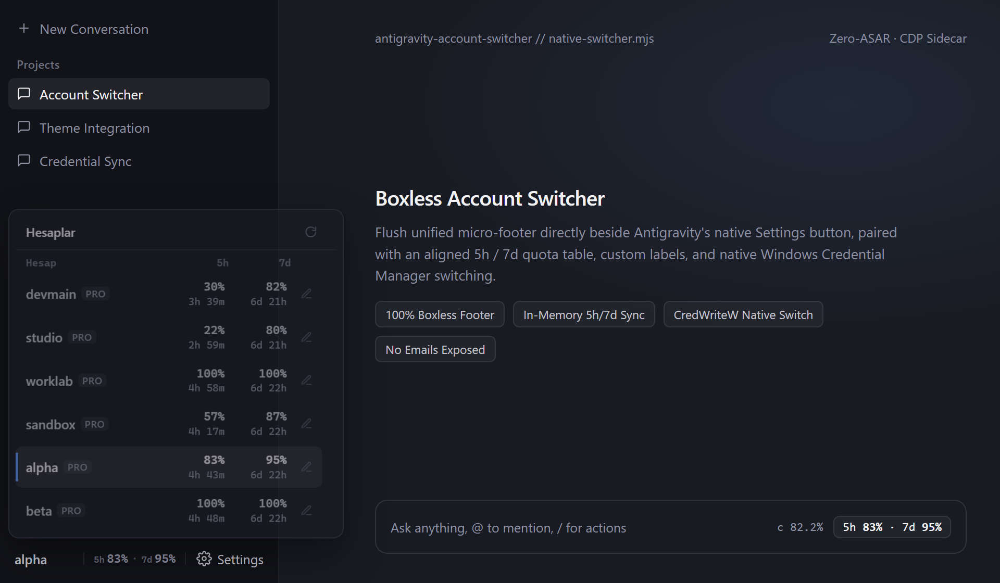
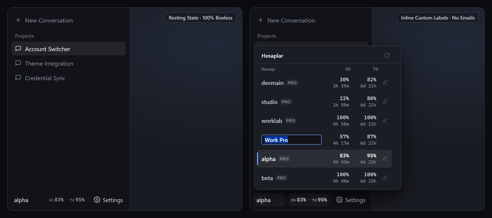
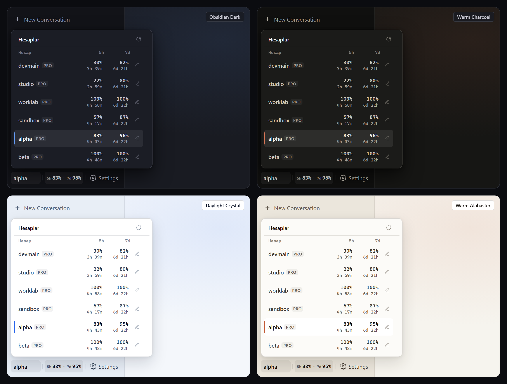

<div align="center">


# Antigravity Account Switcher

**Zero-ASAR, boxless native account switcher plugin for Antigravity on Windows**

[**Türkçe**](./README.md) · [**English**](./README.en.md)

<p>
  
  
  
  <a href="./LICENSE"></a>
</p>



</div>

> **Disclaimer**
>
> This is an independent open-source community plugin and is not affiliated with or endorsed by Google LLC. It is designed to interoperate cleanly with local [Cockpit Tools](https://github.com/jlcodes99/cockpit-tools) storage (`~/.cockpit_tools`) and Windows Credential Manager (`CredWriteW`).

---

## Highlights

- **100% Boxless Unified Micro-Footer:** Integrates flush at the bottom of Antigravity's left sidebar alongside the native `Settings` button (`[Account Label] | [5h % · 7d %] | [⚙ Settings]`), with zero borders, zero cards, and zero green status dots.
- **Aligned Micro-Table (`Hesap | 5h | 7d`):** Clean tabular layout displaying both `5h` and `7d` remaining quota percentages and untruncated reset countdowns (`3h 39m`, `6d 21h`).
- **Privacy-First Custom Labels (`✎`):** Email addresses are never exposed in the UI. Defaults to the email prefix (e.g., `alice.dev` for `alice.dev@example.com`), and any account can be renamed inline via `✎` (`Enter` saves, `Escape` cancels, empty restores default).
- **100% Native Switching (Cockpit Tools Not Required to Run):** Reads `antigravity_accounts.sqlite` and `AES-256-GCM` encrypted `accounts/*.json` envelopes from `%USERPROFILE%\.cockpit_tools` using built-in `node:sqlite` and `node:crypto`, and performs native Windows switching even while Cockpit Tools is closed.
- **Zero-Disk-Write Live Memory Quota Sync:** When [Obsidian Prism](https://github.com/RMvdesi/obsidian-prism) (GravityPrism) is installed, mirrors live `5h` and `7d` quotas directly from its in-memory stream (`__agPulseExternalBridge` and `#five-balance` / `#week-balance` Shadow DOM) without writing or polling snapshot files on disk.
- **4 Theme Palettes + `52px` Collapsed Sidebar:** Automatically adapts via CSS custom properties to Obsidian Dark, Warm Charcoal, Daylight Crystal, Warm Alabaster, and stock Antigravity themes.

---

## Screenshots

### Boxless Footer & Inline Custom Label Editing
<p align="center">
  
</p>

### Multi-Theme Support (Obsidian Dark · Warm Charcoal · Daylight Crystal · Warm Alabaster)
<p align="center">
  
</p>

---

## Requirements

- **OS:** Windows 10 / 11 (uses Windows Credential Manager `CredWriteW` and Task Scheduler COM)
- **Antigravity:** `>= 2.0` (`SystemCredential` auth mode)
- **Local Account Store:** Accounts added at least once via [Cockpit Tools](https://github.com/jlcodes99/cockpit-tools) (`%USERPROFILE%\.cockpit_tools`)
- **Node.js:** Antigravity's bundled `agy-node` runtime (or `Node.js v22+` with built-in `node:sqlite`) — **zero external npm dependencies**

---

## Installation

### Option 1: One-Line PowerShell Clone (Recommended)

```powershell
git clone https://github.com/xnnnc/antigravity-account-switcher.git "$env:USERPROFILE\.gemini\config\plugins\antigravity-account-switcher"
```

### Option 2: Manual ZIP Install

1. Download the repository ZIP from GitHub (**Code → Download ZIP**).
2. Extract it so `plugin.json`, `assets/`, and `sidecars/` sit directly under:
   ```text
   C:\Users\<YOUR_USER>\.gemini\config\plugins\antigravity-account-switcher
   ```

### Enable in Antigravity

1. Open Antigravity and go to **Plugins / Customizations**.
2. Locate **Account Switcher** and enable it.
3. The sidecar daemon (`sidecars/daemon/main.mjs`) starts automatically and mounts beside the bottom `Settings` button. *(If it does not appear right away, reload or restart Antigravity once.)*

---

## Architecture & Security

- **Zero `app.asar` modifications:** Injects purely over local `%APPDATA%\Antigravity\DevToolsActivePort` CDP.
- **Zero HTTP servers:** Renderer communication uses a main-frame-verified `Runtime.addBinding` bridge (`__agAccountSwitcherCall`).
- **Strict secret & PII isolation:** OAuth tokens, encryption keys, and full email addresses never cross into the renderer DOM.
- **Out-of-Job Windows Relaunch:** Because Antigravity launches sidecars inside a `KILL_ON_JOB_CLOSE` Job Object, relaunch runs via Windows Task Scheduler COM (`Schedule.Service`, `TASK_LOGON_INTERACTIVE_TOKEN`), deletes its temporary task entry immediately on startup, waits for Antigravity processes to exit cleanly, and relaunches `Antigravity.exe`.

---

## Updating

> [!NOTE]
> Custom account labels are stored **outside** the plugin folder at `%USERPROFILE%\.gemini\config\antigravity-account-switcher-labels.json`, so your labels are preserved across updates.

### Option 1: Git Clone (Recommended)

```powershell
git -C "$env:USERPROFILE\.gemini\config\plugins\antigravity-account-switcher" pull --ff-only
```

### Option 2: Manual ZIP

1. Download the [latest archive](https://github.com/xnnnc/antigravity-account-switcher/archive/refs/heads/main.zip).
2. Extract and overwrite the existing `%USERPROFILE%\.gemini\config\plugins\antigravity-account-switcher` folder.

### Reloading After Update

Antigravity keeps the plugin sidecar (`sidecars/daemon/main.mjs`) running in memory. To apply backend and UI changes:

1. Toggle **Account Switcher** off and back on under Antigravity → **Plugins / Customizations** *(or restart Antigravity)*.

---

## Verification & Uninstall

Run the non-destructive test suite (uses isolated temp directories and a disposable test credential target — never touches live Antigravity or live credentials):

```powershell
node "$env:USERPROFILE\.gemini\config\plugins\antigravity-account-switcher\tests\verify.mjs"
```

To uninstall, disable **Account Switcher** in Antigravity and remove the plugin folder:

```powershell
Remove-Item -Recurse -Force "$env:USERPROFILE\.gemini\config\plugins\antigravity-account-switcher"
Remove-Item -Force "$env:USERPROFILE\.gemini\config\antigravity-account-switcher-labels.json" -ErrorAction SilentlyContinue
```
