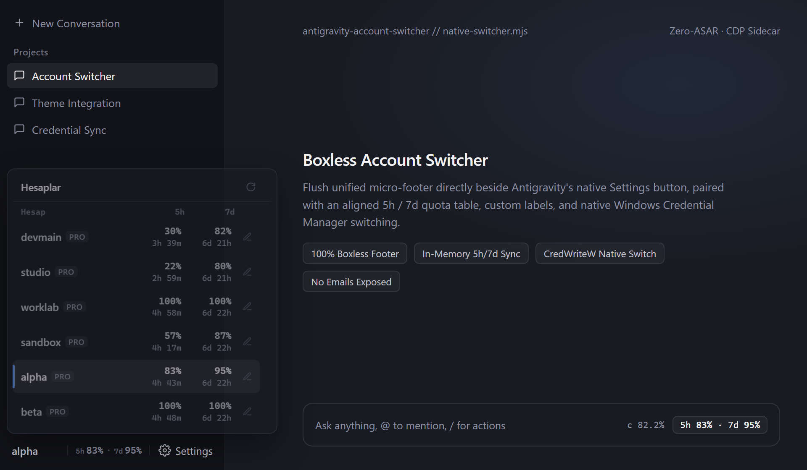
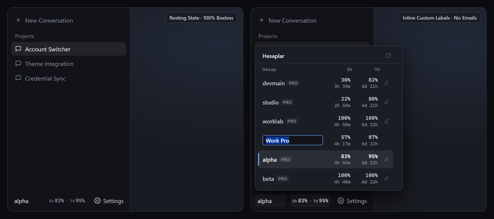
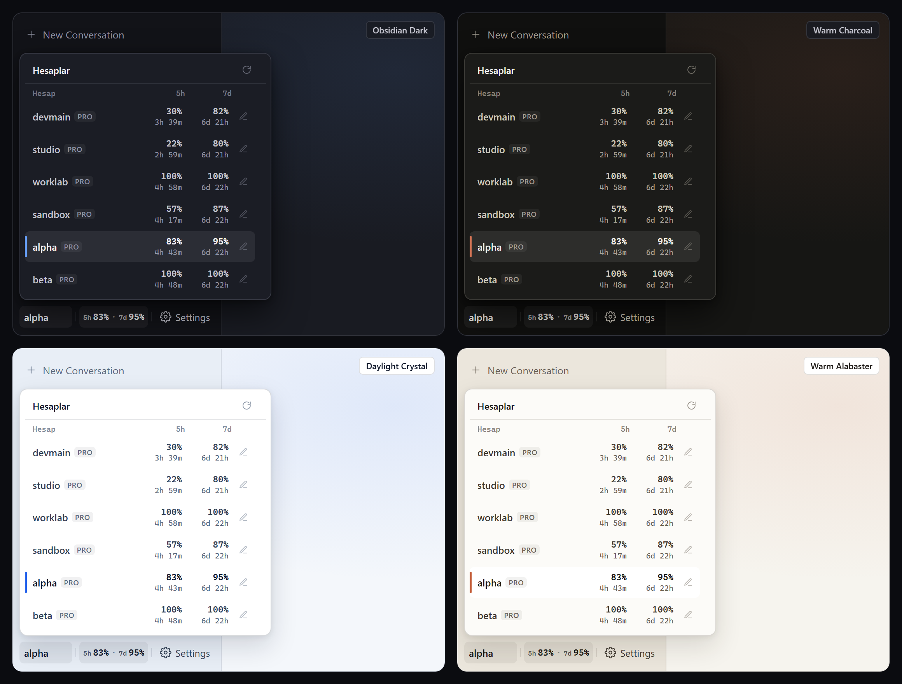

<div align="center">


# Antigravity Account Switcher

**Antigravity için kutusuz (boxless), sıfır `app.asar` müdahaleli yerel hesap değiştirici eklentisi**

[**Türkçe**](./README.md) · [**English**](./README.en.md)

<p>
  
  
  
  <a href="./LICENSE"></a>
</p>



</div>

> **Bilgilendirme & Sorumluluk Reddi**
>
> Bu proje bağımsız ve açık kaynaklı bir topluluk eklentisidir; Google LLC veya Antigravity ile resmi bir bağlantısı yoktur. Yalnızca yerel masaüstü kimlik deposu (`~/.cockpit_tools`) ve resmi Windows Kimlik Bilgisi Yöneticisi (`CredWriteW`) ile uyumlu çalışacak şekilde tasarlanmıştır.

---

## Özellikler

- **%100 Kutusuz (Boxless) Mikro Alt Şerit:** Sol kenar çubuğunun en altında, Antigravity'nin kendi `Settings` butonuyla aynı `31px` düz zeminde `[Hesap Etiketi] | [5h % · 7d %] | [⚙ Settings]` düzeninde bütünleşir; çerçeve, kart kutusu veya dikkat dağıtıcı yeşil durum noktaları içermez.
- **Hizalı Mikro Tablo (`Hesap | 5h | 7d`):** Açılır listede her hesabın `5h` ve `7d` kalan kota yüzdeleri ile sıfırlanma geri sayımları (`3h 39m`, `6d 21h`) kesilmeden, sütun hizasında görüntülenir.
- **E-posta Gizliliği & Özel Etiketler (`✎`):** Arayüzde tam e-posta adresleri hiçbir zaman gösterilmez. Varsayılan olarak e-postanın `@` öncesi ön eki kullanılır; herhangi bir hesabın yanındaki `✎` simgesine tıklayıp satır içi özel etiket (`Work Pro`, `Studio` vb.) tanımlayabilirsiniz (`Enter` kaydeder, `Escape` iptal eder, boş bırakmak varsayılana döndürür).
- **Cockpit Tools Kapalıyken Tamamen Native Geçiş:** Hesapları `%USERPROFILE%\.cockpit_tools` altındaki `antigravity_accounts.sqlite` ve `AES-256-GCM` şifreli `accounts/*.json` dosyalarından okur. Geçiş sırasında Cockpit Tools'un açık olmasına gerek duymadan `jlcodes99/cockpit-tools` ile birebir aynı mantığı çalıştırır.
- **Sıfır Disk Yazmalı Canlı Bellek Senkronizasyonu:** [Obsidian Prism](https://github.com/RMvdesi/obsidian-prism) (GravityPrism) yüklüyse aktif hesabın `5h` ve `7d` kota verilerini diske dosya yazmadan veya diskten periyodik snapshot okumadan doğrudan bellek içi (`__agPulseExternalBridge` & `#five-balance` / `#week-balance` Shadow DOM) akışından anlık olarak aynalar.
- **4 Tema + Daraltılmış (`52px`) Sidebar Desteği:** Obsidian Dark, Warm Charcoal, Daylight Crystal ve Warm Alabaster temalarıyla (ve stok Antigravity temasıyla) CSS değişkenleri üzerinden otomatik uyum sağlar.

---

## Ekran Görüntüleri

### Kutusuz Alt Şerit ve Satır İçi Etiket Düzenleme
<p align="center">
  
</p>

### 4 Tema Uyumluluğu (Obsidian Dark · Warm Charcoal · Daylight Crystal · Warm Alabaster)
<p align="center">
  
</p>

---

## Gereksinimler

- **İşletim Sistemi:** Windows 10 / Windows 11 (Windows Credential Manager `CredWriteW` & Task Scheduler COM kullanır)
- **Antigravity:** `>= 2.0` (`SystemCredential` mimarisi)
- **Yerel Hesap Deposu:** Hesaplarınızın en az bir kez [Cockpit Tools](https://github.com/jlcodes99/cockpit-tools) aracılığıyla `%USERPROFILE%\.cockpit_tools` klasörüne eklenmiş olması gerekir.
- **Node.js:** Antigravity'nin dahili `agy-node` çalışma zamanı (veya sistemde `Node.js v22+`, dahili `node:sqlite` modülü için) — **harici npm bağımlılığı yoktur**.

---

## Kurulum

### Yöntem 1: PowerShell ile Tek Komut (Önerilen)

PowerShell'i açın ve eklentiyi doğrudan Antigravity'nin global eklenti dizinine klonlayın:

```powershell
git clone https://github.com/xnnnc/antigravity-account-switcher.git "$env:USERPROFILE\.gemini\config\plugins\antigravity-account-switcher"
```

### Yöntem 2: Manuel Kurulum (ZIP)

1. Sağ üstten **Code → Download ZIP** ile projeyi indirin.
2. Arşivi şu dizine çıkartın:
   ```text
   C:\Users\KULLANICI_ADINIZ\.gemini\config\plugins\antigravity-account-switcher
   ```
   *(Klasör içinde doğrudan `plugin.json`, `assets/` ve `sidecars/` dosyaları yer almalıdır.)*

### Antigravity İçinde Etkinleştirme

1. Antigravity'yi açın (veya zaten açıksa **Plugins / Customizations** sekmesine girin).
2. Listede **Account Switcher** eklentisini bulun ve **Enable** konumuna getirin.
3. Eklenti etkinleştirildiğinde `sidecars/daemon/main.mjs` otomatik olarak arka planda başlar ve sol alt `Settings` satırının yanında görünür. *(Görünmezse Antigravity penceresini bir kez yeniden yükleyin veya kapatıp açın.)*

---

## Nasıl Çalışır?

1. **Veri Okuma (`cockpit-store.mjs`):**
   - `%USERPROFILE%\.cockpit_tools\antigravity_accounts.sqlite` ve `secure-account-storage.key` kullanılarak şifreli `accounts\<id>.json` dosyaları çözülür (`AES-256-GCM`).
   - Arayüze (`ui-client.js`) **asla** tam e-posta adresi, JWT, `access_token` veya `refresh_token` gönderilmez; yalnızca etiket, kota ve durum bilgileri iletilir.
2. **Native Hesap Değiştirme (`native-switcher.mjs`):**
   - Kilit dosyalarını (`antigravity_account_index.lock` ve `accounts\<id>.json.lock`) gözeterek tekil geçiş kilidi alır.
   - Token süresi dolmak üzereyse (`<= 15 dk`) resmi Google OAuth endpoint'inden yeniler ve şifreli hesap kaydını atomik olarak günceller (`.bak` bırakmaz).
   - Windows Kimlik Bilgisi Yöneticisi'ndeki `gemini:antigravity` kaydını (`CredWriteW`, payload `stdin` üzerinden aktarılır) ve `%USERPROFILE%\.gemini\jetski-standalone-oauth-token` dosyasını atomik olarak yazar; SQLite ve `current_account.json` durumunu senkronize eder.
   - Antigravity sidecar'ları `KILL_ON_JOB_CLOSE` bayraklı bir Windows Job Object içinde çalıştırdığı için, yeniden başlatma betiğini Windows Görev Zamanlayıcı COM (`Schedule.Service`) üzerinden Job-dışı tek seferlik bir görev olarak çalıştırır, görev başlar başlamaz tanımı temizler ve Antigravity'yi temiz bir şekilde yeniden açar.

---

## Güvenlik ve Gizlilik

- **Sıfır `app.asar` yaması:** Antigravity uygulama dosyalarını değiştirmez.
- **Sıfır HTTP sunucusu:** Yalnızca `%APPDATA%\Antigravity\DevToolsActivePort` üzerinden yerel CDP bağlantısı ve `mainFrameId` doğrulamalı `__agAccountSwitcherCall` bağlaması kullanır.
- **Sıfır arka plan kota taraması:** Kota API'lerine periyodik arka plan isteği atmaz.
- **Sıfır periyodik disk yazma:** Normal kullanımda diske yalnızca siz bir hesaba özel etiket atadığınızda veya hesap değiştirdiğinizde yazılır.

---

## Test ve Doğrulama

Kurulumdan sonra bütünlüğü doğrulamak için eklenti dizininde doğrulama paketini çalıştırabilirsiniz *(canlı Antigravity oturumunuza veya canlı kimlik bilgilerinize zarar vermez; tüm yazma testleri izole geçici klasörlerde ve ayrılabilir test hedeflerinde koşar)*:

```powershell
node "$env:USERPROFILE\.gemini\config\plugins\antigravity-account-switcher\tests\verify.mjs"
```

---

## Kaldırma

1. Antigravity → **Plugins / Customizations** sayfasından **Account Switcher** eklentisini devre dışı bırakın.
2. Eklenti klasörünü ve isteğe bağlı özel etiket dosyasını silin:
   ```powershell
   Remove-Item -Recurse -Force "$env:USERPROFILE\.gemini\config\plugins\antigravity-account-switcher"
   Remove-Item -Force "$env:USERPROFILE\.gemini\config\antigravity-account-switcher-labels.json" -ErrorAction SilentlyContinue
   ```
